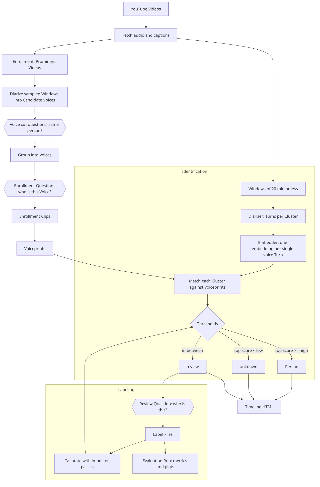

# whodat

Who spoke when in a YouTube video, by name.

whodat diarizes the audio of YouTube videos,
then names each speaker by matching voice embeddings
against voiceprints of known people.
It works on any channel:
everything channel-specific lives in a corpus directory.

[](docs/pipeline.mmd)

## How it works

whodat reads a corpus:
a directory that lists YouTube videos and the people who speak in them.
The manifest gives each video a role.
`enroll` videos teach whodat each person's voice,
`calibrate` videos tune its confidence,
and `eval` videos measure how well it does.
The roster names each person,
gives them a color,
and lists the videos where they talk the most.
Label files hold the ground truth:
who speaks when, in time ranges that you check by ear.

To process a video,
whodat cuts its audio into turns with the pyannote diarizer.
Turns overlap where people talk at once.
whodat embeds the parts where one person talks, with WeSpeaker or ECAPA.
It then compares each embedding with the voiceprint of every person in the roster.
A close match names the person,
a distant match says `unknown`,
and a match in between waits for you to answer by ear.

whodat gives you three outputs:

- label files that grow as you confirm or correct its guesses
- evaluation runs: metrics as JSON and plots as PNG
- an HTML timeline per video, with one colored row per person

The outputs go to `runs/`.
[`runs/example/`](runs/example/) holds them for the oneyplays corpus.

## Walkthrough

The commands below follow the order of the work.
Each step needs the output of the steps before it.

Set up the tools once, as [HACKING.md](HACKING.md) shows:

```bash
mise install && mise run setup
```

Every command works on one corpus.
Give it with `-c corpora/<name>` or `WHODAT_CORPUS`.
Inside this repo, mise sets `WHODAT_CORPUS=corpora/oneyplays` for you.

Commands that do not ask questions print JSON,
so scripts can read their output.
Put `--` before a video id that starts with `-`.

### Create a corpus

A corpus is a directory that you write by hand.
whodat adds to it as you work:

```text
corpora/<name>/
├── manifest.yaml    # you write it: the videos and their roles
├── roster.yaml      # you write it; `whd enroll review` adds clips
├── thresholds.yaml  # `whd calibrate` and `whd enroll review` write it
└── labels/<id>.tsv  # `whd label` and `whd review` write them; you can edit them
```

The directory name is the corpus name.

`manifest.yaml` lists each video by its YouTube id,
the part after `v=` in its URL,
and gives it one role:

```yaml
videos:
  "DZv_IFWdUeg": enroll     # Chris talks the most
  "hzZa-pNiuGw": enroll     # Lyle talks the most
  "-VwAMsgAUvA": calibrate
  "FhrsZIcXLvw": eval
```

Quote the ids, because YAML misreads some of them.
Pick the videos for each role like this:

- `enroll`: for each person, one or more videos where that person talks the most,
  such as a compilation of their best moments
- `calibrate`: typical videos of the channel, with its usual mix of people and guests
- `eval`: more videos like the `calibrate` ones, kept apart to measure whodat

A video can have only one role,
so `calibrate` and `eval` measure whodat on videos it never learned from.

`roster.yaml` lists the people whodat can name:

```yaml
persons:
  chris:
    name: Chris
    color: "#2a78d6"
    prominent: [DZv_IFWdUeg]
  lyle:
    name: Lyle
    color: "#eb6834"
    prominent: [hzZa-pNiuGw]
```

The key, such as `chris`, is the id that label files use.
`name` and `color` appear in questions and timelines.
`prominent` lists the `enroll` videos where that person talks the most.
Leave out `clips`: `whd enroll review` writes them.
whodat rewrites this file, so comments in it do not survive.
Anyone who is not in the roster is `unknown`.

### `whd fetch`

Downloads the audio of every video in the manifest,
with English auto-captions when YouTube has them,
and converts the audio to 16 kHz mono.

```bash
whd fetch
```

Files stay in the cache, so a second run is fast.
Run it again after you add videos to the manifest.

### `whd enroll review`

Teaches whodat each person's voice.
This step needs the fetched audio of the `enroll` videos.

```bash
whd enroll review
```

whodat samples the videos where each person talks the most
and keeps the speech of the dominant voice in each sample.
Each sample is a candidate.
Candidates that sound alike form a voice,
and the questionnaire asks you who each voice is.

How alike is alike enough differs between channels and embedders,
so the first time, whodat asks you.
Each of these questions plays one sample of two groups of candidates:
answer "Same person" or "Different people".
Each answer halves the range of possible cuts,
so a few questions are enough.
whodat saves the cut in `thresholds.yaml` as `voice`,
next to the thresholds of the embedder,
and goes on to the voices.

For each voice, open the links to listen,
then pick a name with its number or with the arrow keys.

After you name a person,
a second screen lists the candidates of that voice,
grouped by whose videos they come from.
Untick a candidate when someone else speaks in it,
for example a clip of another person in a compilation.
Press `o` to listen to the candidate under the cursor,
`enter` to confirm,
or `esc` to go back and pick another name.

Each answer is saved the moment you give it.
The cleanest speech of the ticked candidates
becomes enrollment clips in `roster.yaml`.
On the first screen, press `esc` to see all questions and answer one again,
or `q` to stop and come back later.

To answer without the questionnaire, for scripts and agents:

```bash
whd enroll review -l                               # pending questions as JSON
whd enroll review -s tomar/g4=tomar -d tomar/g6    # one answer, minus a candidate
whd enroll review -a answers.yaml                  # many answers, as ID: VALUE
```

Each questionnaire session also saves its answers in that YAML format,
under `$XDG_STATE_HOME/whodat/<corpus>/answers/`,
so you can replay a session.

### `whd enroll status`

Shows how many enrollment clips each person has
and how many seconds they add up to.
About 2 minutes per person is enough.

```bash
whd enroll status
```

### `whd enroll propose`

Samples a person's videos again with other settings,
for example more or longer windows when a person has too few clips.
`enroll review` runs this for you with the defaults.

```bash
whd enroll propose zach --per-video 5 --minutes 15
```

### `whd enroll reset`

Clears the enrollment clips and answers of some people, or of everyone,
so that `enroll review` asks about their voices again.

```bash
whd enroll reset zach
```

Git tracks `roster.yaml`, so `git restore` undoes a reset.

To answer the "same person?" questions again, forget the cut:

```bash
whd enroll reset --voices
```

Answers to voices that the new cut keeps stay.
Voices that regroup lose their answers and clips,
and `enroll review` asks about them again.

### `whd label`

Adds a scored region to a video and labels it from the voiceprints.
This step needs enrollment clips.
Label regions of your `calibrate` and `eval` videos:
`calibrate` and `evaluate` use them.

```bash
whd label -- FhrsZIcXLvw 00:53:00-00:58:00
```

A scored region is a promise that its labels are complete:
time without a label counts as silence.
A few minutes with the usual mix of voices is a good size.

The diarizer splits the region into clusters,
which are anonymous voices.
In `enroll` videos, clusters with a clear match become labels at once,
and the others wait for your answer.
In `calibrate` and `eval` videos, every cluster waits for your answer,
so that whodat is never graded against its own guesses.

### `whd review`

Asks who speaks in each cluster that waits for your answer.
Each answer labels all the turns of that cluster.

```bash
whd review FhrsZIcXLvw
```

When you finish, the region holds the labels in `labels/FhrsZIcXLvw.tsv`:

```text
# scored 00:53:00.0-00:58:00.0
00:53:02.4  00:53:07.9  chris
00:53:06.8  00:53:09.1  zach
00:53:12.0  00:53:15.5  unknown
```

Each line is a start, an end and a person.
Overlapping lines mean that two people talk at once.
Use `?` when you cannot tell who speaks.
The diarizer can miss speech,
so listen to the region and add or fix lines where it did.

The keys and the options for scripts are the same as in `enroll review`:

```bash
whd review -l FhrsZIcXLvw
whd review -s 3180s/SPEAKER_00=tomar FhrsZIcXLvw
whd review -a answers.yaml FhrsZIcXLvw
```

### `whd audacity`

Exports a label file for Audacity, for corrections that need a waveform.

```bash
whd audacity FhrsZIcXLvw          # write labels/FhrsZIcXLvw.audacity.txt
whd audacity --load FhrsZIcXLvw   # read it back into the label file
```

In Audacity, import the audio from `~/.cache/whodat/media/FhrsZIcXLvw/audio.16k.wav`
and that file as labels.
When you are done, export the labels to the same file.


### `whd calibrate`

Sets the two thresholds that decide when a match is close or distant.
This step needs `calibrate` videos with labeled regions,
from `whd label` and `whd review`.

```bash
whd calibrate
```

The thresholds go to `thresholds.yaml`.
Until you calibrate, whodat uses defaults per embedder.

### `whd evaluate`

Measures whodat on the labeled regions of the `eval` videos,
from `whd label` and `whd review`.
Calibrate first, so the measures use your thresholds.

```bash
whd evaluate
```

Each run writes `metrics.json`, `scores.png` and `confusion.png`
to a new folder under `runs/evaluations/`.
The metrics include accuracy on accepted speech,
the share of speech left for review,
and how often an unknown voice gets a name.

### `whd timeline`

Draws who speaks when across a whole video, as an HTML page.

```bash
whd timeline FhrsZIcXLvw
```

The page goes to `runs/timelines/FhrsZIcXLvw.html`.
When people talk at once, their bars run in parallel.
Hover over a turn to see its score,
and click it to open YouTube at that moment.

## Glossary

The code uses these terms.
"Speaker" is avoided: it can mean a cluster or a person.

### Inputs

| Term | Meaning |
|---|---|
| Corpus | Directory with one manifest, one roster and label files. |
| Video | One YouTube URL, keyed by its video id. |
| Manifest | Lists the corpus videos and their roles. Matching is always against the full roster, never a per-video cast. |
| Role | `enroll` supplies enrollment clips. `calibrate` fits thresholds. `eval` is scored by evaluation runs. One role per video. |
| Held-out video | A `calibrate` or `eval` video. Out-of-distribution means exactly this: a different URL from every `enroll` video. |
| Label file | Hand-editable ground truth for one video. `# scored START-END` lines declare scored regions. |
| Label | `start, end, identity`. Overlapping labels mean crosstalk. |
| Scored region | Time range where labels are exhaustive: no label means no speech. Time outside every scored region is not scored. |

### People

| Term | Meaning |
|---|---|
| Roster | The persons a corpus knows, with their enrollment clips and prominent videos. |
| Person | Roster entry: id, display name, color. |
| Identity | Who a label or prediction says speaks: a person id, `unknown`, `?` or `review`. |
| `unknown` | Speech by anyone outside the roster: guests, game dialogue, played clips. |
| `?` | Label only. The labeler could not tell who spoke. Excluded from identification metrics. |
| `review` | Prediction only. The model could not tell who spoke. |

### Identification

| Term | Meaning |
|---|---|
| Diarizer | pyannote `speaker-diarization-community-1`. |
| Window | Up to 20 minutes of audio diarized at once, to bound memory. |
| Cluster | The diarizer's anonymous voice, scoped to one window, e.g. `600s/SPEAKER_00`. |
| Turn | A time range the diarizer attributes to one cluster. Turns of different clusters overlap during crosstalk. |
| Embedder | Speaker-embedding model: `wespeaker`, the default, or `ecapa`. |
| Prominent video | An `enroll` video where one person dominates. |
| Candidate voice | The dominant cluster of a sampled window of a prominent video, with its clean speech. Its id is `person/gN`. |
| Voice | Candidate voices from any person's prominent videos that sound alike. A compilation of one person often holds another person's voice. |
| Voice cut | The similarity at or above which candidate voices join one voice. Saved per embedder in `thresholds.yaml`, from your answers to "same person?" questions. |
| Enrollment question | "Who is this voice?" Its ticked candidate voices become enrollment clips of the answer. Candidates from the person's own prominent videos start ticked; untick a crowded one to leave it out. |
| Enrollment clip | Clean single-person audio a human confirmed by ear. About 2 minutes per person, cleanest clips first. |
| Voiceprint | A person's reference embedding, rebuilt from enrollment clips. |
| Match | Cosine similarity of an embedding against each voiceprint. |
| Match strategy | `cluster`, the default, names all turns of a cluster from its mean embedding. `cluster+turn-override` also renames turns that strongly match someone else. |
| Thresholds | `high` and `low` cosine scores per embedder. At or above `high`: the top person. Below `low`: `unknown`. In between: `review`. |
| Impostor pass | A rematch with one person's voiceprint removed, so their speech must come out `unknown`. Supplies unknown speech for calibration and metrics. |

### Labeling

| Term | Meaning |
|---|---|
| Questionnaire | A terminal session of enrollment or review questions. Each answer is saved the moment you give it. `↩ Questions` lists them all, so you can answer one again. |
| Review question | "Who is this?" for one cluster: YouTube links with turn lengths and the top matches. One answer labels all its turns. |
| Acoustic hints | Pitch, formants, speaking rate and loudness next to each person's profile. Shown only; they never change a match. |
| Auto label | A label written from an accepted match. Never on held-out videos: there, every cluster becomes a review question. |

### Outputs

| Term | Meaning |
|---|---|
| Timeline | Self-contained HTML per video: a row per identity, colored by person. Hover for the score; click to open YouTube there. |
| Evaluation run | Metrics and plots over `eval` videos: accuracy on accepted speech, abstain rate, forced accuracy, `unknown` false-accept rate for real and impostor speech. |

## Decisions

Design decisions and their trade-offs are in [docs/adr](docs/adr).
